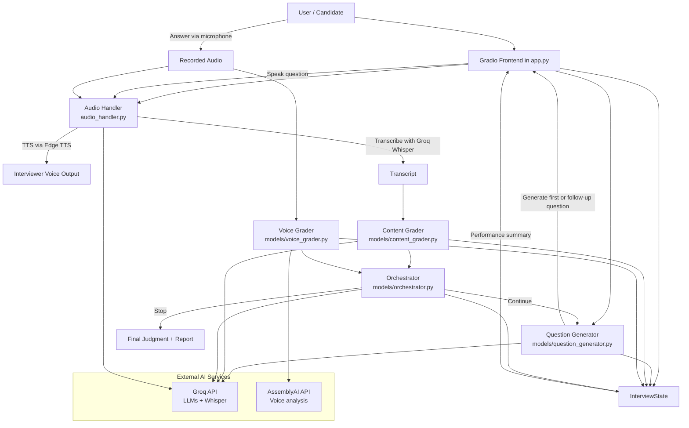

# AI Interview Trainer

An AI-powered mock interview application that helps job candidates practice for technical and behavioral interviews. The app generates interview questions for a target role and experience level, evaluates spoken answers, and delivers a final performance summary.

## Live Demo

Try the hosted application here: https://ai-interview-trainer-b6fv.onrender.com/

## Features

- Role-based interview simulation for a user-defined job role
- Experience-aware question generation
- Speech-to-text transcription of candidate answers
- AI content grading for technical depth and communication quality
- Voice delivery analysis for spoken performance
- Dynamic follow-up questions based on strengths and weaknesses
- Final summary and recommendation after the interview flow ends
- Gradio-based browser interface

## Tech Stack

- Python
- Gradio
- Groq LLMs for question generation, content evaluation, and routing logic
- Groq Whisper for audio transcription
- Edge TTS for interviewer voice output
- AssemblyAI for voice analysis

## Project Structure

```text
AI-Interview-Trainer/
├── app.py                  # Gradio UI and interview workflow entry points
├── audio_handler.py        # Audio transcription and text-to-speech helpers
├── graph.py                # Interview turn logic and grader orchestration
├── state.py                # Interview state schema and initialization
├── models/
│   ├── content_grader.py   # Evaluates the content of the candidate response
│   ├── orchestrator.py     # Decides whether to continue or stop the interview
│   ├── question_generator.py # Creates next interview questions
│   └── voice_grader.py     # Analyzes speaking speed, fillers, and tone
├── requirements.txt        # Python dependencies
├── LICENSE
├── README.md
└── .gitignore
```

## System Architecture

The application follows a modular, event-driven interview pipeline. The browser UI is built with Gradio, while each interview turn is managed by a central state object and orchestrated through the `graph.py` workflow.



### Architecture Overview

1. `app.py` manages the user interface and triggers each turn of the interview.
2. `state.py` holds the current interview state, including chat history, metrics, and routing information.
3. `graph.py` coordinates the full turn lifecycle:
   - capture candidate audio
   - transcribe the answer
   - run content and voice grading in parallel
   - decide whether to continue or end the interview
   - generate the next question when needed
4. `audio_handler.py` handles both speech-to-text and text-to-speech.
5. The `models/` package contains the specialized intelligence layer:
   - `question_generator.py` creates follow-up questions
   - `content_grader.py` scores technical and communication quality
   - `voice_grader.py` measures delivery metrics like speaking rate, fillers, and sentiment
   - `orchestrator.py` decides when the interview should stop and summarizes the outcome
6. Groq and AssemblyAI provide the external AI services used for transcription, grading, and voice analysis.

## How It Works

1. The user enters their target job role and experience level.
2. The app generates the first interview question using Groq.
3. The interviewer speaks the question using text-to-speech.
4. The candidate answers aloud.
5. The answer is transcribed with Groq Whisper.
6. The system grades the response for:
   - technical quality
   - communication quality
   - voice delivery
7. The orchestrator decides whether to continue or end the interview.
8. A new question is generated if the interview continues.
9. The process repeats until the interview ends or a stopping condition is reached.

## Setup

### Prerequisites

- Python 3.9+
- A Groq API key
- An AssemblyAI API key

### Install dependencies

```bash
pip install -r requirements.txt
```

### Run the app

```bash
python app.py
```

Then open the local Gradio URL shown in the terminal.

## Using the App

1. Open the app in your browser.
2. Enter your Groq API key and AssemblyAI API key.
3. Choose the role and experience level.
4. Click Start Interview.
5. Answer each question using your microphone.
6. Submit the answer and review the AI-generated feedback.

## Notes

- The app currently prompts for API keys directly in the interface rather than reading them from environment variables.
- Dependencies are managed through `requirements.txt` for easier setup.
- The application is intended for learning and interview practice, not as a production-grade hiring system.

## Future Improvements

- Add persistent interview history and saved reports
- Support multiple interview templates and question banks
- Add analytics dashboards for trends across sessions
- Improve voice grading interpretability and user feedback
- Add authentication and user accounts

## License

This project is licensed under the [MIT License](LICENSE).
